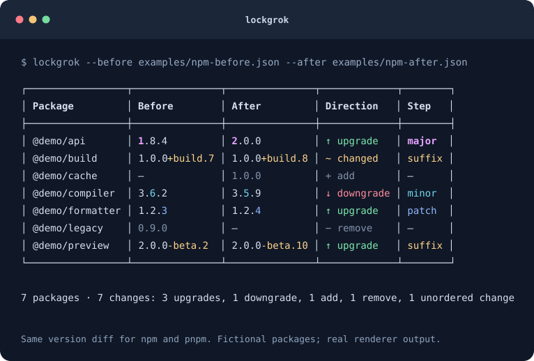

# lockgrok

Compare **npm and pnpm dependency changes** in terminal tables. Labels and colors
distinguish upgrades from downgrades and identify major, minor, patch, and suffix
changes.



## Try it

Requires **Node.js 22.13 or newer**. Git is needed only for revision comparisons.

Run it from your project directory:

```sh
npx lockgrok
```

Or install it globally:

```sh
npm install -g lockgrok
# Or: pnpm add -g lockgrok
lockgrok
```

The default comparison is HEAD against the working tree. To select a different
project directory, use `lockgrok --cwd /path/to/project`.

License scope and third-party notices are documented
in [LICENSE-STATUS.md](LICENSE-STATUS.md).

## Compare revisions or files

Compare Git revisions with positional arguments:

```sh
lockgrok                     # HEAD → working tree
lockgrok main                # main → working tree
lockgrok main HEAD           # main → HEAD
lockgrok main HEAD ./app     # select a project directory
```

Explicit options avoid ambiguity if a ref has the same name as a directory:

```sh
lockgrok --from main --to HEAD --cwd ./app
lockgrok --manager pnpm
lockgrok --lockfile ./locks/package-lock.json
```

`disk` means the working tree and can appear on either side. Git revisions are
verified and read without checking out a branch or modifying the project.
Autodetection searches the selected directory and then its repository ancestors.
If both npm and pnpm lockfiles exist at the selected level, choose `--manager`
or `--lockfile`. For npm, shrinkwrap takes precedence independently in each
snapshot, including a conversion between the two npm lockfile names.

Compare saved files without a repository, including a package-manager migration:

```sh
lockgrok --before old/package-lock.json --after new/package-lock.json
lockgrok --before old/pnpm-lock.yaml --after new/pnpm-lock.yaml
lockgrok --before package-lock.json --after pnpm-lock.yaml
```

A missing file at a **valid Git revision** represents an empty dependency set,
so adding or deleting a lockfile reports its dependencies as additions or removals.
Invalid revisions, unreadable files, and missing explicit `--before`/`--after`
files are errors.

## Choose columns and color

The default columns are **Package · Before · After · Direction · Step**. A
separate **Context** column appears automatically when several reported changes
to the same package need their consumers distinguished. Package names remain
plain: no appended paths or `(transitive)` labels. **Scope** is available as an
optional column.

```sh
# Hide the step column.
lockgrok --columns package,before,after,direction

# Hide the direction column.
lockgrok --columns package,before,after,step

# Only the package and two versions; colored version components still help.
lockgrok --columns package,before,after

# Custom column order.
lockgrok --columns direction,step,package,before,after

# Always show dependency context, or suppress automatic context.
lockgrok --context always
lockgrok --context never

# Scope and context are independent, optional columns.
lockgrok --columns package,context,before,after,direction,step,scope

lockgrok --no-color
lockgrok --color always
```

`--context` accepts `auto` (the default), `always`, or `never`. An explicit
`--columns` list wins: it controls exactly which columns appear, in which order.

A compact summary follows the table, for example
`1 package · 2 changes: 1 upgrade, 1 downgrade`. The package count means distinct
names; the change count means reported rows, which may include several consumers
of one package. `--no-summary` suppresses the summary; `--details` adds details
independently.

Direction uses green for upgrades, red for downgrades, and yellow for changes
without an ordering. Additions and removals use `+ add` and `− remove`; their
action label and present version use muted gray (ANSI 90). Step colors are
independent: bold magenta for major, cyan for minor, blue for patch, yellow for
suffix. The affected version component is highlighted as well. Arrows, words,
and column labels remain present without color.

`--color auto` is the default. It enables color for terminals, respects nonempty
`NO_COLOR`, supports `FORCE_COLOR` (`0` disables it), and disables automatic color
for `TERM=dumb`. An explicit `--color always` or `--no-color` takes precedence.
Piped output is plain unless color is explicitly requested or forced.

In a terminal, long package names, reference contexts, and versions wrap to the
available width without truncation. On narrow terminals, output may exceed the
requested width to keep headings and direction labels readable. ANSI commands,
control characters, and bidirectional controls in input values cannot create
terminal commands or fake rows.

## What the labels mean

| Before | After | Direction | Step |
| --- | --- | --- | --- |
| `1.9.4` | `2.0.0` | ↑ upgrade | major |
| `3.6.2` | `3.5.9` | ↓ downgrade | minor |
| `1.2.3` | `1.2.4` | ↑ upgrade | patch |
| `2.0.0-beta.2` | `2.0.0-beta.10` | ↑ upgrade | suffix |
| `1.0.0-rc.1` | `1.0.0` | ↑ upgrade | suffix |
| `1.0.0+build.7` | `1.0.0+build.8` | ~ changed | suffix |
| `link:../old` | `link:../new` | ~ changed | unknown |
| absent | `1.0.0` | + add | — |
| `1.0.0` | absent | − remove | — |

The step is the highest changed numeric component, or `suffix` if only prerelease
or build metadata changed. This also applies to `0.x` versions; a step label is
not a claim about API compatibility. Numeric prerelease identifiers compare
numerically. Build metadata has no SemVer precedence, so a build-only change is
not labeled as an upgrade or downgrade. The implementation uses
[node-semver](https://github.com/npm/node-semver) for precedence, following
[SemVer 2.0.0](https://semver.org/).

## Supported lockfiles and matching

| Manager | Files | Supported format versions |
| --- | --- | --- |
| npm | `package-lock.json`, `npm-shrinkwrap.json` | 1, 2, 3 |
| pnpm | `pnpm-lock.yaml` | 5.4, 6.x, 9.x |

Direct, development, optional, and transitive dependencies are included. Root and
workspace manifest metadata are excluded from dependency version inventories;
installed local links remain visible.
Scoped names, npm aliases, multiple versions, pnpm peer variants, and opaque Git,
URL, or local references are handled. For a multi-document pnpm lockfile, the
last document is the project's dependency graph; a preceding toolchain document
is excluded, as described in [pnpm's reader guidance](https://github.com/pnpm/pnpm/blob/main/pnpm/docs/lockfile.md).

Comparison has two stages:

1. **Follow declared consumer relationships.** Matching starts at corresponding
   project/importer roots and follows each dependency alias recursively. For npm,
   declarations resolve through the installation tree, including hoisting and
   local workspace links. A different physical path is not a different consumer.
   For pnpm, nodes retain their complete snapshot and peer identities separately
   from the semantic version. Children remain comparable when the parent upgrades
   or selects another peer variant. Unchanged, unpaired consumers can also seed
   comparison when project declarations are missing.
2. **Compare remaining package/version inventories.** Remove common versions and
   versions already covered by relationship changes. Pair exactly one unmatched
   old version with one unmatched new version. Multiple unmatched versions remain
   additions/removals. The details/report API identifies inventory inference
   separately from a matched dependency relationship.

For example, if `web` switches `shared` from `1.0.0` to `2.0.0` while `api`
switches from `2.0.0` to `1.0.0`, both rows are reported, even though the overall
version set remains `{1.0.0, 2.0.0}`. If npm merely hoists those same resolutions
to different paths, there is no version change. If a pnpm host's own version stays
unchanged but a newly selected peer variant resolves a different child, the child
change is reported without inventing a host version bump.

Matching is deterministic and independent of input order. A dependency alias
switching to a different package name produces a remove/add pair. Comparing npm
with pnpm uses inventories, because their graph identities are unrelated. Public
API callers supplying `references` without graphs use installation-reference
matching; parsed lockfiles use dependency graphs.

### Scope, workspaces, and details

```sh
# Inspect all versions and consumers of one package, including retained versions.
lockgrok --package shared --details

# Select several exact package names.
lockgrok --package shared --package @scope/tool

# Compare dependencies reachable from one workspace (path relative to the lockfile).
lockgrok --workspace apps/web --details
lockgrok --workspace . --scope direct

# Filter transitive relationships, with explicit scope labels if desired.
lockgrok --scope transitive --columns package,before,after,direction,step,scope
```

Scope describes the dependency relationship relative to the selected project
roots, not a permanent property of a package name:

| Scope | Meaning |
| --- | --- |
| `direct` | Declared by a selected project root |
| `transitive` | Reached through another dependency |
| `both` | The same reported relationship/version is direct for one selected root and transitive for another |
| `unknown` | The lockfile does not establish a relationship to a selected root |

With no workspace selection, all declared roots participate. `--workspace PATH`
limits matching and version inventories to the selected project's reachable
dependencies. `.` selects the lockfile root. npm workspaces come from workspace
declarations; pnpm projects come from importers. A workspace available on either
side is selectable, so added/removed projects can be inspected. The CLI rejects
unknown workspace paths and lists the available projects. The pure API treats
an unknown path as an empty selection.

`--scope direct` and `--scope transitive` also include `both`; `--scope both` and
`--scope unknown` select those exact categories. The default is `all`. npm v1
and incomplete lockfiles can lack root declarations; a top-level installation
alone does not prove directness. Details aggregate scope separately for each
version, so one package can have direct, transitive, and unknown uses.

`--details` includes the complete before/after version sets, retained versions,
consumers and selected project paths, and evidence for each reported change.
An explicitly selected package can be inspected even if it has no version
changes. Semantic versions are sorted numerically, including prerelease numbers.
Opaque references follow semantic versions and use deterministic text ordering.
Filtered summaries report shown and total package/change counts; totals are
measured within the selected workspace before package/scope filters.

### Reporting boundaries

This is a dependency version and source-reference diff. It ignores integrity-only
changes, manifest-range-only changes, dependency-category moves, and installation
copy counts. A peer-label change alone is not a SemVer change, but the graph still
follows that peer selection to compare its resolved dependencies.

A newly added or removed reference to a version already present elsewhere is not
usually a version change; complete consumer lists remain available in details.
Alias retargeting is an explicit exception, because its target package changed.
Where no consumer pairing exists, singleton unmatched inventories may establish
an inferred version change; ambiguous sets stay as add/remove rows. Unreachable
catalog entries remain in the default inventory with unknown scope, and are
excluded by a workspace selection. This tool does not guess parent relationships
from two unrelated version sets.

## JSON and CI exit codes

```sh
lockgrok main HEAD --json
lockgrok main HEAD --exit-code
lockgrok main HEAD --details --json
```

`--json` produces one valid JSON array, with no color or explanatory text:

```json
[
  {
    "package": "example",
    "before": "1.2.3",
    "after": "2.0.0",
    "direction": "upgrade",
    "step": "major"
  }
]
```

Contextual changes also contain a `context` string. An absent version is `null`.
For additions/removals, `direction` is `"add"`/`"remove"` and `step` is
`null`. These action names are also the public `DiffRow` type discriminants.
An empty result is `[]`. `--json` produces this array with or without filters;
it does not add summary or scope fields to each row.

`--details --json` emits a structured `DiffReport` object with `changes`,
`packages`, `summary`, `total`, and an optional selected `workspace`. Each change
contains `row`, `match` (`dependency`, `installation`, or `inventory`), `scope`,
and before/after `references`. Full snapshot/location IDs remain available in
those references even when their human labels are the same. Each package detail
contains all before/after versions, `retained` versions, consumer uses, and its
selected changes. Neither JSON form contains ANSI coloring.

| Exit | Meaning |
| --- | --- |
| `0` | Success; with `--exit-code`, no selected changes |
| `1` | Selected changes found, only when `--exit-code` is enabled |
| `2` | Invalid options, invalid lockfile, or a file/Git error |

## TypeScript API and Effect

The package is native ESM. Importing it exposes functions and types without
starting the CLI. CommonJS consumers on supported Node.js versions can also use
`require("lockgrok")`; both loading modes are tested, including applications
that import Effect alongside the parser.

```ts
import { Effect } from "effect";
import { parseLockfile, createDiffReport, renderReport } from "lockgrok";

const program = Effect.gen(function* () {
  const before = yield* parseLockfile(oldText, "before-lockfile");
  const after = yield* parseLockfile(newText, "after-lockfile");
  const report = createDiffReport(before, after, {
    workspace: "apps/web",
    packages: ["shared"],
    scope: "all",
  });
  return renderReport(report, { color: true, context: "always", details: true });
});

console.log(await Effect.runPromise(program));
```

`diffLockfiles(before, after)` returns `readonly DiffRow[]`; `renderTable(rows)` produces
only the table. Use `createDiffReport` and `renderReport` for filtering, summaries,
and details. Graph and report types are exported from the package entry point.
Inputs are not mutated.

`parseLockfile` returns `Effect<Lockfile, LockfileError>`. File and Git access use
Effect with `SourceError`; argument validation uses `InputError`. The runtime
boundary validates unknown input using Effect Schema and field guards. Errors
are represented in the type system and formatted once at the executable boundary.
Classification, matching, and rendering are pure functions using readonly data
and discriminated unions.

| Module | Responsibility |
| --- | --- |
| `src/parseLockfile.ts` | Decode/validate npm and pnpm input and normalize source/version identities |
| `src/npmGraph.ts`, `src/pnpmGraph.ts` | Resolve declared consumers and preserve snapshot/link identities |
| `src/graphIndex.ts` | Index relationships, project reachability, and scope |
| `src/classifyChange.ts` | SemVer direction and highest changed component |
| `src/diffLockfiles.ts` | Consumer matching, conservative inventory fallback, and detailed reports |
| `src/renderTable.ts`, `src/renderReport.ts` | Terminal-safe tables, colors, summaries, and details |
| `src/sources.ts` | Typed filesystem/Git reads and lockfile selection |
| `src/options.ts`, `src/cli.ts`, `src/index.ts` | Options, orchestration, and process boundary |
| `src/api.ts`, `src/model.ts`, `src/errors.ts` | Public API, data model, and error types |

## Development and TDD

With Nix, `nix develop` provides Node.js 24 (matching `.nvmrc`), its bundled
npm/npx, and Git. `flake.lock` pins the toolchain. The shells support Linux and
macOS on x86_64 and aarch64. Enable `nix-command` and `flakes` in your Nix
configuration before using them.

For automatic activation, install direnv and enable its
[shell hook](https://direnv.net/docs/hook.html), then run `direnv allow` in this
checkout. The checked-in `.envrc` uses direnv's
[`use flake`](https://direnv.net/man/direnv-stdlib.1.html#codeuse-flake-ltinstallablegtcode);
nix-direnv can optionally cache the environment. Dependencies are installed
explicitly with `npm ci` after entering the shell:

```sh
npm ci
npm run check          # strict typecheck, Biome, tests, build, preview freshness
npm run preview        # regenerate both SVG and PNG previews
npm run preview:check  # read-only, exact-byte preview freshness check
npm run watch          # compile on changes
```

Run checks with the pinned Node 22 toolchain using
`nix develop .#node22 -c npm run check`. This uses the Node 22 patch version in
`flake.lock`; CI still checks the exact minimum supported version, 22.13.0, as
well as Node 24. Update the Nix toolchains with `nix flake update nixpkgs` and
check both shells before committing the updated lockfile.

Tests cover npm and pnpm lockfile formats using committed fixtures; they do not
need a globally installed pnpm or switch package-manager versions at runtime.
For manual checks with a specific manager version, use npm's executable runner,
for example `npm exec --yes --package=npm@11.9.0 -- npm --version` or
`npm exec --yes --package=pnpm@11.25.0 -- pnpm --version`. These commands may
download the requested tools into npm's cache. Fixture regeneration has separate
exact toolchain requirements in the
[fixture reproduction guide](src/tests/fixtures/parser-generated/README.md).

The preview command runs the actual CLI against the npm and pnpm examples,
verifies that their output matches, and generates both
`docs/table-preview.svg` and `docs/table-preview.png`. `npm run demo` is an alias
for `npm run preview`. PNG generation uses pinned `@resvg/resvg-js` 2.6.2 and
bundled DejaVu Sans Mono fonts, independently of system fonts.
The SVG requests DejaVu Sans Mono with a generic monospace fallback for viewers
without that font installed.

After changing the renderer or example inputs, run `npm run preview`, review both
images, and commit both generated files together. `npm run preview:check` compares
the expected SVG and PNG bytes with the checked-in images without rewriting them.
It fails if either image is missing or stale. This check runs at the end of
`npm run check` and `prepack`, so CI and `npm pack` enforce the same freshness
requirement.

Tests use `node:test`, `node:assert/strict`, and `tsx`. For behavior changes,
start with a failing test, implement the change, and run the relevant suite
before the full check. Coverage includes parsing, dependency matching, workspace
scope, CLI and API output, Git access, package contents, and terminal rendering.
See [Testing](docs/testing.md) for commands and coverage details.

## Code and local distribution

The preview images, example inputs, fonts and their documentation, testing guide,
and agent skills and their notices remain in the source checkout and are excluded
from the npm package. The package retains the diff-package-lock provenance notice.
This README's relative preview image is available in a source checkout but not
in an installed package.

Both production and development code use one TypeScript configuration with
`strict`, `noUncheckedIndexedAccess`, `exactOptionalPropertyTypes`,
`noImplicitReturns`, `noFallthroughCasesInSwitch`, `noUnusedLocals`, and
`noUnusedParameters`. Biome checks formatting, imports, and correctness, with
modern Node.js conventions enabled.

File/Git reads and validation failures are composed with Effect and typed tagged
errors. Pure transformations remain plain TypeScript functions. The build and
preview scripts also use Effect for their fallible operations. The build removes
its output directory before compiling, so removed modules cannot survive in a
package. Tests verify the actual executable identity, clean rebuilds, CommonJS
and ESM API imports, and the package export boundary.

To build from source and try the included examples:

```sh
git clone https://github.com/VladimirMarko/lockgrok.git
cd lockgrok
npm ci
npm run build

# Both commands produce the same seven changes.
node dist/index.js --before examples/npm-before.json --after examples/npm-after.json
node dist/index.js --before examples/pnpm-before.yaml --after examples/pnpm-after.yaml
```

To produce and install a local artifact:

```sh
npm run preview
# Review and commit both preview images if they changed.
npm run check
npm pack
npm install -g ./lockgrok-0.1.0.tgz
# Or: pnpm add -g ./lockgrok-0.1.0.tgz
lockgrok --help
```

Review and install the generated tarball locally. No command in this workflow
commits, tags, pushes, or publishes. Before npm publication, review ownership and maintainer information,
package contents, and applicable third-party terms. License scope and the maintainer's
publication decision are recorded in [LICENSE-STATUS.md](LICENSE-STATUS.md).

For version tags, GitHub release notes, and npm trusted publishing, see the
[release procedure](https://github.com/VladimirMarko/lockgrok/blob/master/docs/releasing.md).

## Format references

- [npm package-lock format](https://docs.npmjs.com/cli/v11/configuring-npm/package-lock-json/)
- [pnpm lockfile v6](https://github.com/pnpm/spec/blob/master/lockfile/6.0.md)
- [pnpm lockfile v9 and snapshots](https://github.com/pnpm/spec/blob/master/lockfile/9.0.md)
- [pnpm multi-document reader guidance](https://github.com/pnpm/pnpm/blob/main/pnpm/docs/lockfile.md)
- [Effect schema validation](https://effect.website/docs/v4/schema/getting-started/)

## License and provenance

This is an independent project derived from
[diff-package-lock](https://github.com/adiktofsugar/diff-package-lock), with its own
package name and command. The project's original code is ISC-licensed.
See [LICENSE-STATUS.md](LICENSE-STATUS.md) for third-party scope and permission
records, and [NOTICE.md](NOTICE.md) for upstream provenance.

[ISC license](LICENSE) · [License scope](LICENSE-STATUS.md) · [Upstream provenance](NOTICE.md) ·
[Upstream declared-license reference](third-party-notices/diff-package-lock.txt).
